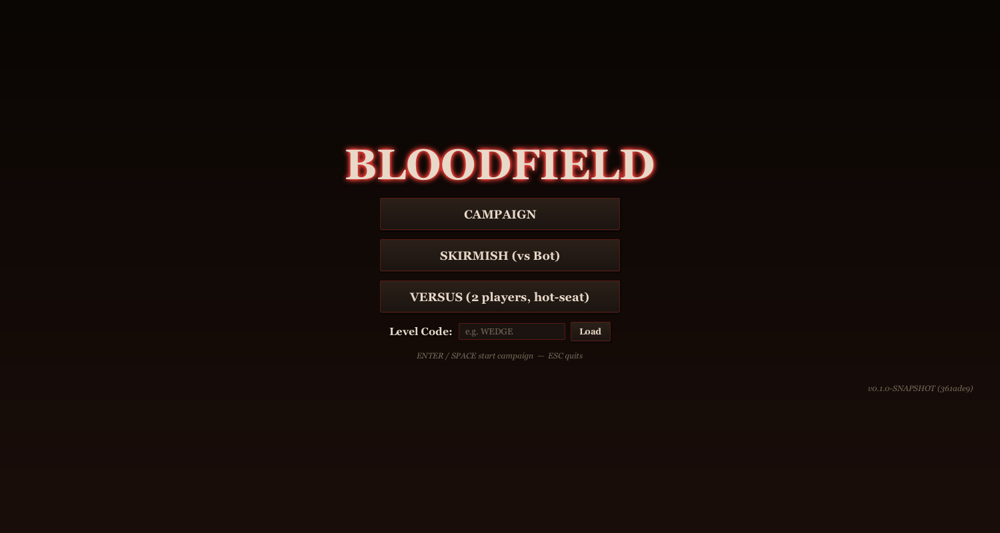
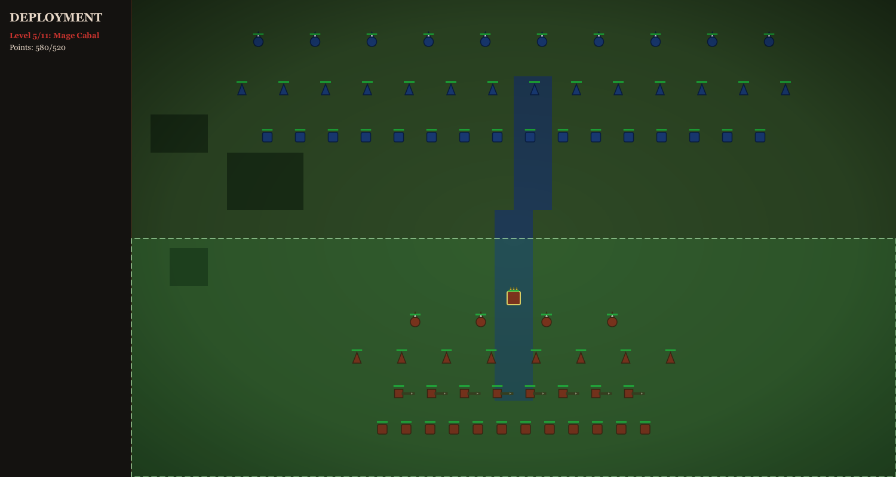
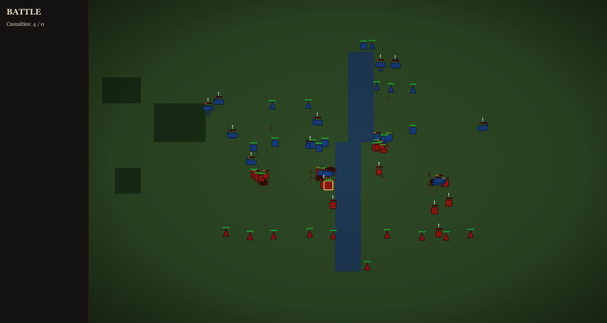
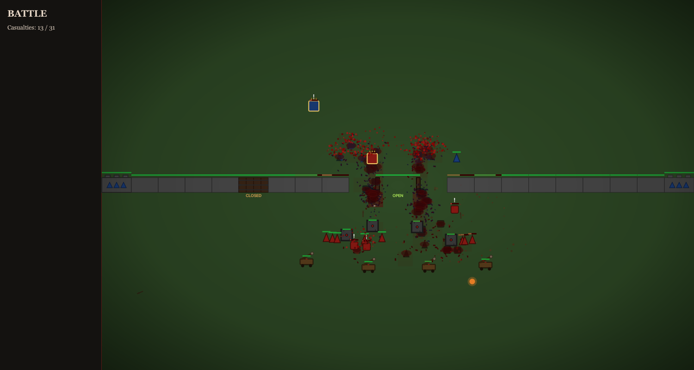
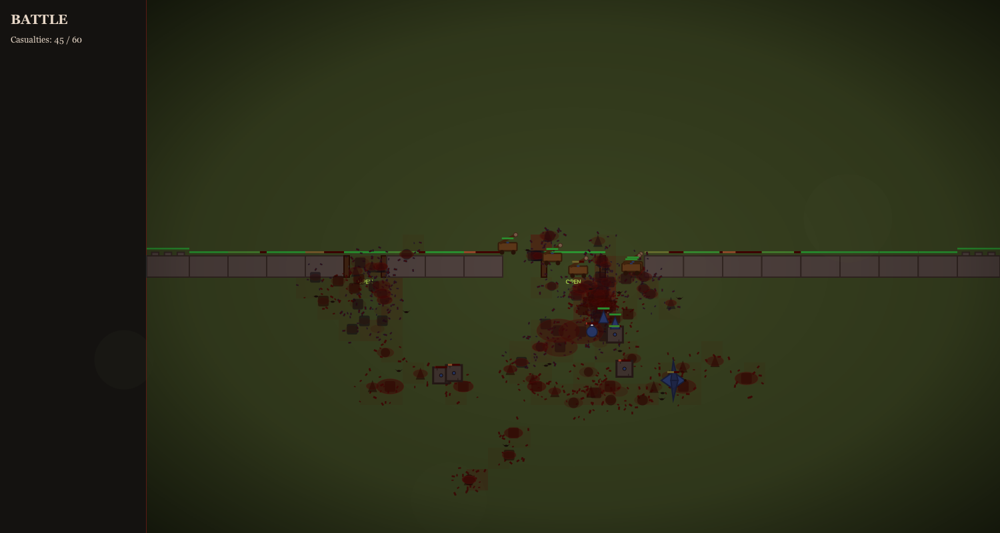
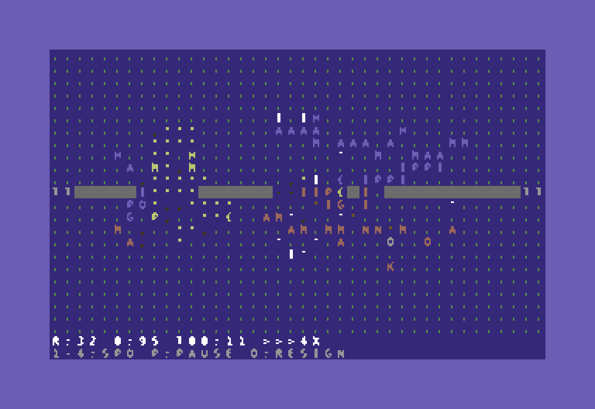
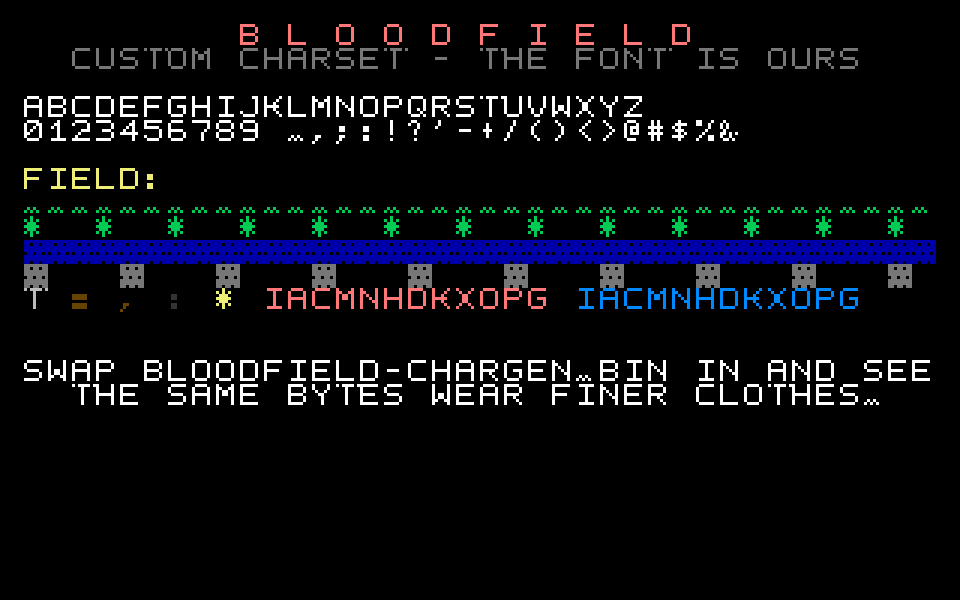

```
▓▓▒▒░ ▄▄▄▄▄▄▄▄▄▄▄▄▄▄▄▄▄▄▄▄▄▄▄▄▄▄▄▄▄▄▄▄▄▄▄▄▄▄▄▄▄▄▄▄▄▄▄▄▄▄▄▄▄▄ ░▒▒▓▓
▓▓▒░     ____  _                 _  __ _      _     _         ░▒▓▓
▓▒░▒    | __ )| | ___   ___   __| |/ _(_) ___| | __| |___     ▒░▒▓
▒░      |  _ \| |/ _ \ / _ \ / _` | |_| |/ _ \ |/ _` / __|      ░▒
░       | |_) | | (_) | (_) | (_| |  _| |  __/ | (_| \__ \       ░
        |____/|_|\___/ \___/ \__,_|_| |_|\___|_|\__,_|___/
░▒▓                                                            ▓▒░
▓▒░        armies clash.   bones break.   crows feast.         ░▒▓
▒░▓                                                            ▓░▒
         ╱│╲ ╱│╲ ╱│╲  †   ▓▒░  ▒▓▓▒  ░▒▓   †  ╱│╲ ╱│╲ ╱│╲
          │   │   │     ▓▒░ blood-soil ░▒▓     │   │   │
         ╱ ╲ ╱ ╲ ╱ ╲                          ╱ ╲ ╱ ╲ ╱ ╲
▓▓▒▒░ ▀▀▀▀▀▀▀▀▀▀▀▀▀▀▀▀▀▀▀▀▀▀▀▀▀▀▀▀▀▀▀▀▀▀▀▀▀▀▀▀▀▀▀▀▀▀▀▀▀▀▀▀▀▀ ░▒▒▓▓
```

## Disclaimer

> This game was **fully vibe-coded** — no design doc, no roadmap, no plan beyond
> "make it gnarly". PRs are welcome. New **vibe-coded** features are even more
> welcome. If something's broken, weird, or you have an idea, [open an issue](https://github.com/rzo1/bloodfields/issues).

## About

Bloodfield is a top-down auto-battler. You place an army during a deployment phase,
then watch the carnage unfold in real time — heroes rallying, archers volleying,
cavalry crashing into infantry, dragons charring whole columns. Three modes:
**Campaign** (six escalating levels with codes), **Versus** (2-player hot-seat with
hidden deployment), **Skirmish** (you vs. an AI bot). Heroes carry skills that
buff nearby allies. Terrain matters. Weather matters. Structures hold lines.
Corpses don't disappear — they pile up, blacken, get pecked at by crows, and rot.

## Screenshots

| Main menu | Deployment |
|---|---|
|  |  |

| Battle | Fortress wall |
|---|---|
|  |  |



## Download

Pre-built installers and native CLI binaries for macOS, Windows, and Linux are
published at **<https://rzo1.github.io/bloodfields/>**. Releases are built
automatically by GitHub Actions on every `v*` tag push (matrix across all three
OSes), and the page links straight to the latest artifacts.

## Quickstart

```bash
mvn javafx:run                               # run from source
# or build the fat jar:
mvn -DskipTests package
java -jar target/bloodfields-1.2.0-SNAPSHOT-all.jar
```

Java 21 required. The shade plugin produces `bloodfields-1.2.0-SNAPSHOT-all.jar`
in `target/` — the artifact ID stays as-is to keep build paths stable.

### Regenerate screenshots

The PNGs under `docs/screenshots/` are generated by a headless tool that boots
JavaFX via Monocle, so it works on CI runners without a display server:

```bash
mvn -Pscreenshots verify -DskipTests
```

Outputs go to `docs/screenshots/` (`menu.png`, `deployment.png`, `battle.png`,
`fortress.png`, `finale.png`). The `screenshots` profile pulls in
`org.pdfsam:javafx-monocle` only when activated.

## Headless CLI

There is a JavaFX-free CLI for scripted/LLM play. See `docs/CLI.md` for the full
command reference.

```bash
mvn -DskipTests package
java -cp target/bloodfields-1.2.0-SNAPSHOT-all.jar com.github.rzo1.bloodfields.cli.CliMain levels
java -cp target/bloodfields-1.2.0-SNAPSHOT-all.jar com.github.rzo1.bloodfields.cli.CliMain level 5
printf '%s\n' \
  '{"op":"place","type":"INFANTRY","x":640,"y":700}' \
  '{"op":"start"}' \
  '{"op":"step","ticks":3600}' \
  '{"op":"state"}' \
  '{"op":"quit"}' \
  | java -cp target/bloodfields-1.2.0-SNAPSHOT-all.jar com.github.rzo1.bloodfields.cli.CliMain play 1
```

A `bin/bloodfields-cli` wrapper is included.

## C64 telnet server (PETSCII)

There is a telnet server frontend that plays the whole game — menus, campaign,
skirmish, deployment, real-time battle — in PETSCII on a Commodore 64's
40x25 color text screen. The world is 1280x800 on 32-pixel tiles: exactly
40x25 tiles, one tile per character cell, faction carried by color RAM (you
are light red, the enemy is light blue). Rows 23-24 carry the HUD, so the
board is a 23-row viewport that scrolls over all 25 tile rows — it follows
your deployment cursor and the fighting in battle (marker at the end of the
HUD line), and every tile row stays reachable.

```bash
mvn -DskipTests package
# Emulator on this machine (default bind is loopback only):
java -cp target/bloodfields-1.2.0-SNAPSHOT-all.jar com.github.rzo1.bloodfields.cli.CliMain telnet --port=6400
# Real C64 hardware on your LAN (telnet has no authentication — trusted networks only):
java -cp target/bloodfields-1.2.0-SNAPSHOT-all.jar com.github.rzo1.bloodfields.cli.CliMain telnet --port=6400 --bind=0.0.0.0
```



Then connect from your C64 with a PETSCII terminal (CCGMS, StrikeTerm) over a
WiFi modem / RR-Net / emulator RS-232 bridge and `ATDT host:6400` — set the
terminal's background to black, or the blue river blocks drown in the stock
blue screen. From a PC any telnet client works for input (ANSI arrows and
`DEL`/`BS` are translated to the C64 cursor keys, CRLF line endings are
handled), but use a PETSCII-capable terminal to see the colors and graphics
as intended.

- Campaign: all 11 levels, victory prints the next level code.
- Skirmish: pick a map, a budget (100-10000), and enemy dragon opt-in; the
  bot deploys against you.
- Deployment: cursor keys move, `1`-`0`/`G` pick a unit, `SPACE` places,
  `DEL` removes, `K` cycles the hero skill, `S` starts the battle.
- Battle: `1`-`4` set speed (0.5x-4x), `P` pauses, `Q` resigns.

The renderer diffs frames and only re-sends rows that changed. Measured
frames: ~1.5 KB for a full repaint, a few hundred bytes typically, up to
~700 B at 4x speed in a busy battle. At 9600 baud roughly 670 B fit in one
700 ms frame, so 0.5x-2x stay ahead of the link and 4x peaks lag slightly —
writes are deadline-bounded and pace the frame loop (backpressure), never
queued without bound, and a client that stops reading entirely is dropped
after 10 s instead of holding its session slot forever. Necromancers work:
deaths are tracked server-side from the first tick and fed into the corpse
field. Weather is shown but (like the rest of the CLI) does not alter
combat. Code lives in `com.github.rzo1.bloodfields.telnet`.

### Optional: the Bloodfield character ROM

The build designs and generates a complete replacement C64 character set —
an original block font plus refined battlefield glyphs (grass tufts, wavy
river/masonry blocks, a crenellated `T` for towers) — assembled into a
4096-byte chargen ROM image, `bloodfield-chargen.bin`, packaged in the jar
at build time by `C64CharsetTool`. The telnet byte stream does not change;
the same bytes simply wear finer clothes once the ROM is swapped in:

- Emulator: point the chargen/character ROM at `bloodfield-chargen.bin`
  (extract it from the jar), or
- Real C64 / RAM charset: load the first 2048 bytes at `$3000`, then
  `POKE 53272,28` (screen at `$0400`, charset at `$3000`) before starting
  your terminal, if your terminal respects `$D018`.

No Commodore ROM bytes are shipped; every bitmap is designed in
`telnet/C64Charset.java`. The screenshots in `docs/screenshots/c64/` are
rendered by the committed `C64CharsetTool` (Pepto palette), e.g.
`13-custom-charset.png`:



Add `--proxy=host:port` and the telnet server becomes a frontend for a remote
2-player gRPC match instead of local play (see below).

## Two-player over gRPC

`grpc-server` hosts one 2-player match over a single long-lived bidirectional
streaming RPC — there are no unary calls; both players keep a `Play` stream
open for the whole match. The contract is symmetric: the hosting side and the
joining side use the same stream, so the host plays through exactly the same
client interface as the guest (and so does the telnet proxy).

```bash
java -cp target/bloodfields-1.2.0-SNAPSHOT-all.jar com.github.rzo1.bloodfields.cli.CliMain grpc-server --port=6411
```

Match flow: both players join → lobby (first player configures map, budget,
dragons; both ready-up) → deployment (each side places into its own half of
the field) → real-time battle streamed at ~4 Hz (either side can set speed,
pause, or resign) → result → rematch vote. **Both sides can save and restore
state**: a save request snapshots the full match — units, projectiles,
corpses, fires, structures, per-side caps/stats, even AI RNG continuity —
seals it with the server's HMAC key, and delivers the bytes to *both*
players. Restoring is a **parley**: one side proposes, the other must consent
(telnet: `7`/`8`), so nobody can unilaterally rewind a losing battle;
forged or foreign snapshots fail the seal check and field validation before
they touch the engine. Saves/restores are rate-limited, frames coalesce for
slow readers instead of queueing without bound, and a dropped player can
reclaim their seat mid-battle with the reconnect token from their `Welcome`
(strangers cannot). Up to eight extra streams may **spectate** (`spectate`
on join): spectators receive every frame, save/restore event, and herald
notice ("A DRAGON HAS FALLEN") but their commands are rejected — and a C64
arriving to a full match is offered the gallery in PETSCII (`W` to watch).

The wire is **plaintext and unauthenticated by default** — tokens and
snapshot seals guard seats and scrolls, not the connection. For an
encrypted wire, serve TLS and dial it from the proxy:

```bash
openssl req -x509 -newkey rsa:2048 -keyout key.pem -out cert.pem -days 825 -nodes \
  -subj "/CN=hostA" -addext "subjectAltName=DNS:hostA"
java -cp ... CliMain grpc-server --port=6411 --bind=0.0.0.0 --tls=cert.pem:key.pem
java -cp ... CliMain telnet --port=6400 --proxy=hostA:6411 --proxy-tls=cert.pem
```

(`--proxy-tls` without a PEM trusts the platform roots; with one it pins that
certificate. The C64-to-proxy telnet leg is inherently plaintext, so run the
proxy on a trusted machine near the C64 and let TLS guard the long haul.)
The server binds to loopback by default; serving beyond this machine is
explicit (`--bind=0.0.0.0`) and should happen only on a trusted network.
Snapshot seals are ephemeral by default (they die with the server); pass
`--snapshot-key=...` (or set `BLOODFIELD_SNAPSHOT_KEY`) for seals that
survive restarts.

The contract is one file, [`src/main/proto/bloodfield.proto`](src/main/proto/bloodfield.proto)
(package `bloodfields.v1`), and any gRPC client can play. The telnet server
proxies it, so two C64s can fight each other over the internet:

```bash
# machine A hosts the match (LAN play)
java -cp ... CliMain grpc-server --port=6411 --bind=0.0.0.0
# machine A (or anywhere) serves PETSCII sessions bridged to the match
java -cp ... CliMain telnet --port=6400 --proxy=hostA:6411
```

Code lives in `com.github.rzo1.bloodfields.net`.

## Native installer

Bloodfield can be packaged as a native installer that bundles its own JRE, so
end users do not need to install Java. The build uses `jpackage` (ships with
JDK 17+) wired through the `org.panteleyev:jpackage-maven-plugin`.

```bash
mvn -Ppackage-native package -DskipTests
```

Output goes to `target/installers/`:

| Host OS    | Artifact                              |
|------------|---------------------------------------|
| macOS      | `Bloodfield-<ver>.dmg`                |
| Windows    | `Bloodfield-<ver>.msi`                |
| Linux      | `bloodfield_<ver>_<arch>.deb`         |

The installer type is selected automatically from the host OS. `jpackage` only
produces installers for the platform it runs on — for cross-platform releases,
run the same command on each target OS.

Notes:
- Build requires JDK 17+ on `PATH` (jpackage). The project itself targets Java 21.
- The macOS DMG is unsigned. macOS Gatekeeper will block it on first launch;
  right-click the app and pick "Open" to bypass, or sign it with your own
  Developer ID by adding `--mac-sign` options to the plugin config.
- The Windows MSI is unsigned for the same reason.
- App version is set via the `jpackage.appVersion` Maven property
  (defaults to the released app version); override with `-Djpackage.appVersion=...`.
  jpackage requires the first version segment to be a positive integer,
  which is why this is decoupled from the project's `-SNAPSHOT` versions.

## Native binary (GraalVM)

The headless **CLI** (`com.github.rzo1.bloodfields.cli.CliMain`) can be compiled to
a standalone native binary with GraalVM `native-image`. No JVM, no JDK, no
JavaFX — just a single executable that boots in milliseconds. Convenient for
LLM-driven play, scripted simulations, and CI.

This is a separate, complementary path to the jpackage installer above:
`package-native` ships the GUI to end users with a bundled JRE; `package-graal`
ships the headless CLI as a true compiled native binary.

Prerequisites:
- A GraalVM 21+ JDK on `PATH` (or via `GRAALVM_HOME` / `JAVA_HOME`).
  Liberica NIK and Oracle GraalVM both ship `native-image` by default; on
  older distributions install it with `gu install native-image`.

Build:

```bash
mvn -Ppackage-graal package -DskipTests
```

Output: `target/bloodfields-cli` (the binary name is set by the
`graal.imageName` Maven property; override with `-Dgraal.imageName=...`).

`native-image` only walks the call graph reachable from `CliMain`, so the
JavaFX UI tree is not pulled in. If you add new reflective code paths or
dynamic resource lookups in the CLI, harvest the configs by re-running under
the tracing agent:

```bash
mvn -Pcollect-graal-config exec:exec -Dexec.args="<your CLI args>"
```

That writes `reflect-config.json`, `resource-config.json`, etc. to
`src/main/resources/META-INF/native-image/`, which the next `package-graal`
build picks up automatically.

### GUI native build (deferred)

A `package-gui-native` profile is wired for `com.gluonhq:gluonfx-maven-plugin`
as a placeholder, but JavaFX + native-image is significantly harder than the
CLI case: it needs Gluon's Substrate, platform toolchains (Xcode / MSVC /
GCC + dev libs), and exhaustive reachability metadata. **Treat as future
work**; no support claim is made today. End users wanting the GUI should use
`package-native` (jpackage) above.

## Modes

- **Campaign** — Six levels of escalating difficulty. Win a level to receive a
  code that lets you jump back in later without replaying earlier stages.
- **Versus** — Two-player hot-seat. Each player deploys behind a privacy
  blackout, picks a hero skill, and optionally toggles dragon opt-in. Budget is
  configurable from 100 to 10,000 points. Reserves and per-player handicap (HP
  multiplier) round out the matchup.
- **Skirmish** — Single player vs. the bot. Same deployment rules as versus.

## Units

| Unit         | Role            | HP  | Damage | Range | Cost | Notes                                      |
|--------------|-----------------|-----|--------|-------|------|--------------------------------------------|
| INFANTRY     | Melee line      | 50  | 10     | 18    | 10   | Counters archers.                          |
| ARCHER       | Ranged          | 30  | 8      | 180   | 15   | +50% vs cavalry.                           |
| CAVALRY      | Charger         | 80  | 15     | 20    | 25   | +50% vs infantry. Dies to archers.         |
| MAGE         | Ranged AoE      | 35  | 18     | 140   | 30   | Splash 50. Slow, fragile.                  |
| DRAGON       | Boss            | 600 | 80     | 110   | 999  | Flying — ignores terrain and walls. Fire breath. Opt-in only. Never routs. |
| NECROMANCER  | Corpse-bender   | 60  | 8      | 130   | 50   | Revives or detonates corpses.              |
| HEALER       | Support         | 40  | 0      | 80    | 35   | Heals nearby allies. No damage.            |
| CATAPULT     | Siege           | 120 | 35     | 240   | 60   | Splash 70. Boulder projectile.             |
| ASSASSIN     | Skirmisher      | 25  | 22     | 18    | 30   | Fast. Armor-piercing.                      |
| GOLEM        | Tank            | 300 | 20     | 22    | 80   | Slow walking wall. Devastating in melee.   |
| PIKEMAN      | Anti-cavalry    | 55  | 11     | 25    | 15   | Spear line.                                |
| GENERAL      | Hero            | 180 | 18     | 22    | 100  | Unique. +25% damage aura. Carries skill.   |

## Hero Skills

The General can be equipped with one of five auras. Buff applies to allies in range.

- **Battle Lust** — Allies nearby deal +25% damage.
- **Iron Discipline** — Allies nearby take 25% less damage.
- **Swift Strike** — Allies nearby attack 30% faster.
- **Vampiric Banner** — Allies nearby heal 20% of damage dealt.
- **Swift Feet** — Allies nearby move 30% faster.

## Maps

- **Open Plains** — Pure grass. Nowhere to hide.
- **Crossing** — A wide river splits the field; one narrow bridge in the middle.
- **Twin Rivers** — Two rivers, bridges on opposite flanks.
- **Deep Woods** — Dense forest patches break sightlines and slow movement.
- **The Gauntlet** — A diagonal river funnels armies through forest chokepoints.
- **Fortress** — Forest ring walls around the player's deployment zone.
- **Crossroads** — Two perpendicular rivers form a cross with central bridges.
- **The Mire** — Forests everywhere. Slow grinding battle.
- **Peninsula** — Three sides of water funnel armies into a tight battlefield.
- **Badlands** — Scattered forest mounds and a serpentine river.
- **Fortress Wall** — Horizontal wall with twin towers and a central gate.

## Weather

- **Clear** — Cloudless skies. No combat effect.
- **Fog** — Thick fog reduces ranged attack range by 30%.
- **Rain** — Soaked ground slows units by 15%.
- **Snow** — Cosmetic. Falls quietly on the dead.
- **Night** — Darkness reduces ranged attack range by 20%.

## Controls

| Key       | Action                                  |
|-----------|-----------------------------------------|
| `1`       | 0.5× speed                              |
| `2`       | 1× speed (normal)                       |
| `3`       | 2× speed                                |
| `4`       | 4× speed                                |
| `P`       | Pause / unpause                         |
| `R` / `B` | Bring in reserves                       |
| `?` / `H` | Toggle controls & help overlay          |
| `ESC`     | Back to main menu                       |
| `ENTER`   | Start campaign / confirm                |
| `SPACE`   | Start campaign (from result screen)     |

## Gore features

- Blood splashes on every kill, scaled to the size of the unit that died.
- Corpses persist on the field — they don't despawn. Necromancers can revive
  them or blow them up (friendly fire included).
- Bloody tile overlay accumulates where the slaughter is heaviest.
- Decomposing remains darken over ~30 seconds before settling into bone piles.
- Severed limbs and stuck arrows litter the battlefield.
- Charred corpses where dragon fire passed through.
- Scorch marks from catapult splash.
- Crows circle, then descend on the casualty fields. Vultures pick at bones.
- Screen shake on heavy impacts. Catapult boulders, dragon strafes, golem
  slams.
- Casualty-darkened vignette — the more bodies, the darker the screen edges.
- Red sky on later campaign levels. The sun gives up.

```
░▒▓ † † † † † † † † † † † † † † † † † † † † † † † † † † † † † † † † † † † † † † ▓▒░
```
