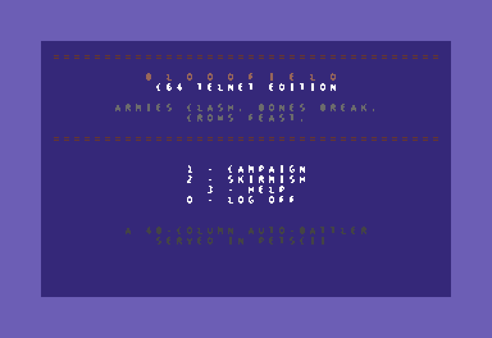
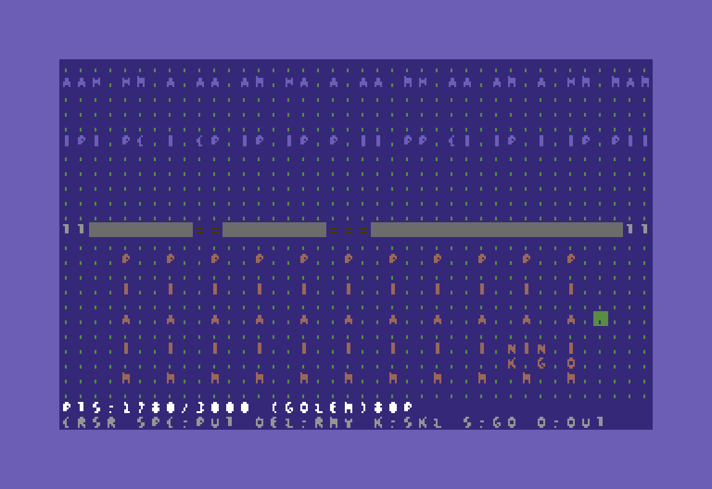
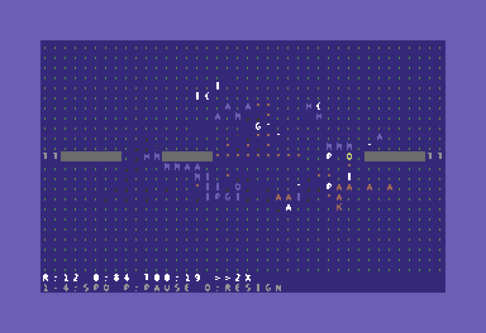
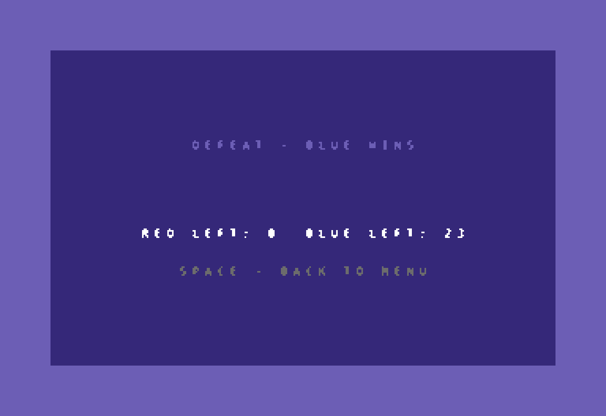

# Bloodfield CLI

A headless, JavaFX-free entry point so external programs (LLMs, scripts, tournaments) can drive battles. Lives in `com.github.rzo1.bloodfields.cli`.

## Build and run

```bash
mvn -DskipTests package
java -cp target/bloodfields-1.2.0-SNAPSHOT-all.jar com.github.rzo1.bloodfields.cli.CliMain help
```

A wrapper is provided at `bin/bloodfields-cli`:

```bash
bin/bloodfields-cli help
```

## Subcommands

### `levels`

Print all campaign levels as a JSON array. Each entry has `number`, `name`, `code`, `mapId`, `weather`, `playerBudget`, `playerCaps`.

```bash
bin/bloodfields-cli levels
```

### `level <n|code>`

Print a single level's full details: terrain ASCII, enemy roster, structures, deployment zone, caps. The argument is `1..N` or a level code (e.g. `SKIRMISH`, `FUCKERY`).

```bash
bin/bloodfields-cli level 5
bin/bloodfields-cli level CABAL
```

### `maps`

Print all map presets as a JSON array (id, name, description).

### `map <id>`

Show ASCII terrain for a single map.

ASCII glyphs:

| Glyph | Meaning |
|-------|---------|
| `.`   | grass |
| `~`   | river |
| `*`   | forest |
| `#`   | wall |
| `T`   | tower |
| `=`   | gate (closed) |
| `_`   | gate (open) |

Units (lowercase = RED, uppercase = BLUE):

| Type | Glyph |
|------|-------|
| INFANTRY | `i` / `I` |
| ARCHER | `a` / `A` |
| CAVALRY | `c` / `C` |
| MAGE | `m` / `M` |
| DRAGON | `d` / `D` |
| NECROMANCER | `n` / `N` |
| HEALER | `h` / `H` |
| CATAPULT | `k` / `K` |
| ASSASSIN | `x` / `X` |
| GOLEM | `o` / `O` |
| PIKEMAN | `p` / `P` |
| GENERAL | `g` / `G` |

### `play <spec>`

Interactive REPL. `<spec>` is `<n>`, a level code, or `map:<mapId>:<budget>` (skirmish-style: empty enemy army).

Reads one JSON command per line from stdin and emits one JSON response per line on stdout.

Commands:

```json
{"op":"place","type":"INFANTRY","x":640,"y":700}
{"op":"remove","x":640,"y":700}
{"op":"set_hero_skill","skill":"BATTLE_LUST"}
{"op":"start"}
{"op":"step","ticks":60}
{"op":"state"}
{"op":"quit"}
```

Example (campaign level 1):

```bash
printf '%s\n' \
  '{"op":"place","type":"INFANTRY","x":640,"y":700}' \
  '{"op":"start"}' \
  '{"op":"step","ticks":3600}' \
  '{"op":"state"}' \
  '{"op":"quit"}' \
  | bin/bloodfields-cli play 1
```

### `sim <spec> --red=<file> [--blue=<file>] [--max-ticks=N]`

Fully scripted run. Loads RED (player) and optionally BLUE (enemy) armies from JSON, then runs to victory or `--max-ticks` (default 18000 = 5 in-game minutes at 60 Hz).

Army file format:

```json
{
  "heroSkill": "BATTLE_LUST",
  "units": [
    {"type": "INFANTRY", "x": 640, "y": 700},
    {"type": "ARCHER",   "x": 600, "y": 750}
  ]
}
```

For campaign specs the enemy is auto-spawned from the level's spawner; pass `--blue=` only when running against a custom roster on `map:` specs.

```bash
bin/bloodfields-cli sim 1 --red=examples/red.json
```

### `telnet [--port=N] [--sessions=N] [--proxy=host:port]`

Starts a Commodore 64 telnet server that serves the game in PETSCII (40x25
color text mode). Lives in `com.github.rzo1.bloodfields.telnet`. Default port
is 6400; `--sessions` caps concurrent players (default 8).

```bash
java -cp target/bloodfields-1.2.0-SNAPSHOT-all.jar com.github.rzo1.bloodfields.cli.CliMain telnet --port=6400
```

Connect from a C64 with a PETSCII terminal program (CCGMS, StrikeTerm) and a
telnet-capable link (WiFi modem cartridge, RR-Net, or an emulator's RS-232
bridge). The server renders the battlefield as a 40x23 PETSCII minimap with
color-coded armies, a 2-line HUD, and full menu/deployment/battle flow —
campaign (all 11 levels, level codes on victory) and skirmish against the
bot. Controls: cursor keys + SPACE/DEL in deployment, `1`-`4` speed, `P`
pause, `Q` resign in battle.

The rendering layer (`PetsciiScreen`) sends only rows that changed between
frames, which keeps the game playable over slow links (9600 baud and up).
Weather multipliers are display-only here, matching the rest of the CLI.

Captured from a live session (PETSCII stream rendered with the C64 palette):

| | |
| --- | --- |
|  |  |
|  |  |

The full set of screens (menu, help, level select, unit keys, deployment,
battle, result, goodbye) is in [`docs/screenshots/c64/`](screenshots/c64/).

With `--proxy=host:port` the telnet server does not run local games at all:
each session joins the 2-player gRPC match at the given address as a player
(RED or BLUE, first come first served). Two C64s (or a C64 and any other
client speaking the contract) can then fight the same battle. The proxy flow
mirrors the streamed match phases: a war-council lobby (RED picks map /
budget / dragons with `M`/`B`/`D`, `R` readies up), deployment into your own
half, the live battle (`1`-`4` speed, `P` pause, `Q` resign, `5` save, `6`
restore the last snapshot this session received), and the result screen
(`R` votes for a rematch).

### `grpc-server [--port=N]`

Hosts one 2-player match over gRPC (default port 6411). The API is a single
bidirectional streaming RPC — `Bloodfield.Play(stream PlayerMessage) returns
(stream GameMessage)`, see `src/main/proto/bloodfield.proto`; there are no
unary calls, and the same contract serves the hosting side and the joining
side alike.

```bash
java -cp target/bloodfields-1.2.0-SNAPSHOT-all.jar com.github.rzo1.bloodfields.cli.CliMain grpc-server --port=6411
```

- First stream to join plays RED (the host, who configures the match), the
  second plays BLUE; a third is told the match is full.
- The server is authoritative: it validates placement (zone, budget, caps)
  and runs the battle simulation at 60 Hz, broadcasting state frames about
  four times per second.
- Either player can save the match at any time after the lobby: the server
  snapshots the full state and sends the bytes to **both** players. Either
  player can later send a snapshot back to restore the match to exactly that
  point, mid-battle included. Snapshots are opaque, versioned protobuf blobs
  (`Snapshot`) — store them wherever you like.
- After a battle ends, both players readying up starts a rematch on the same
  configuration. A disconnect before the battle resets the match to the
  lobby; a disconnect mid-battle leaves the abandoned army standing until
  the result is decided.

Any gRPC client can play; `telnet --proxy=...` (above) is the built-in one.

## Notes

- The CLI is JavaFX-free and lives in `com.github.rzo1.bloodfields.cli`. It reuses `model/`, `engine/`, and `ai/`.
- Deployment uses the same gating as the JavaFX `DeploymentController`: zone check, terrain passability, budget, unique cap, per-type cap.
- World is fixed at 1280x800 with 32-pixel tiles.
